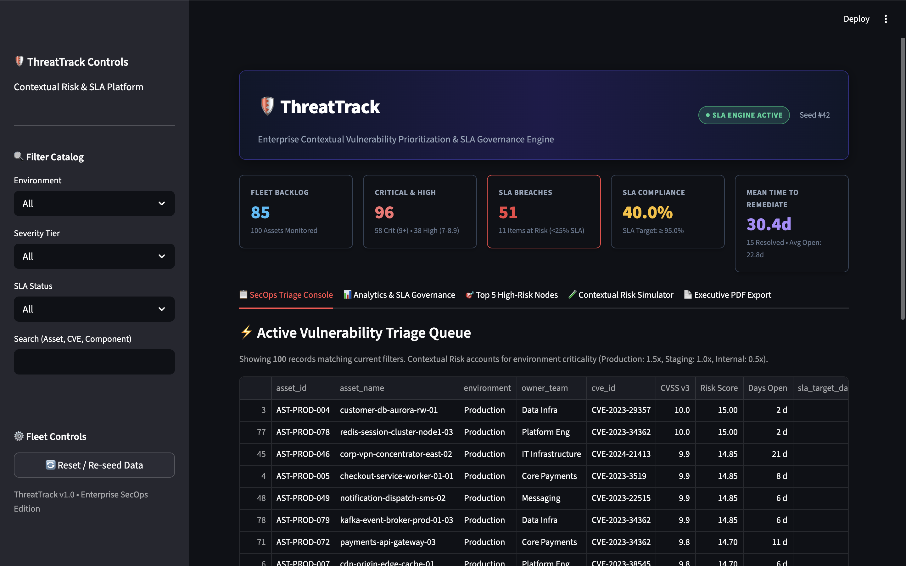
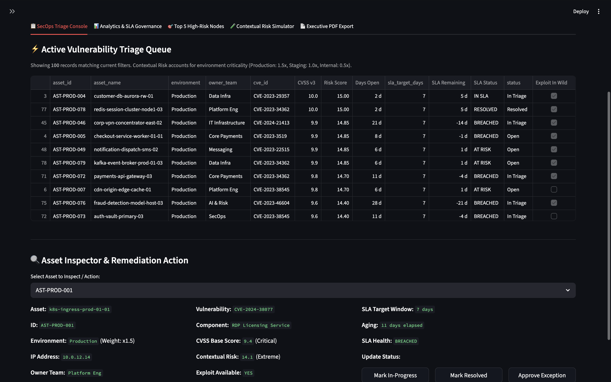
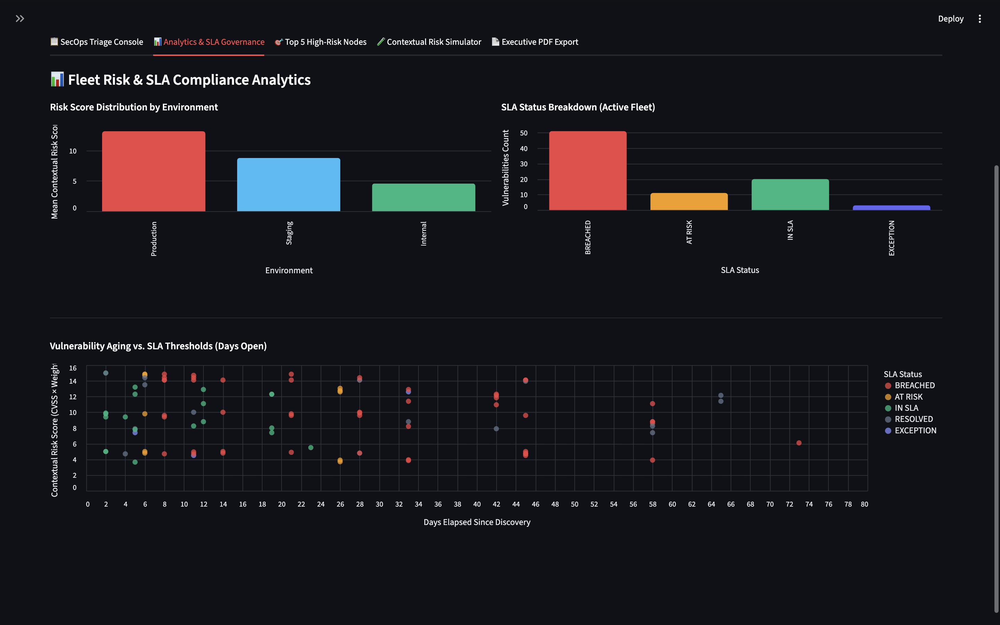
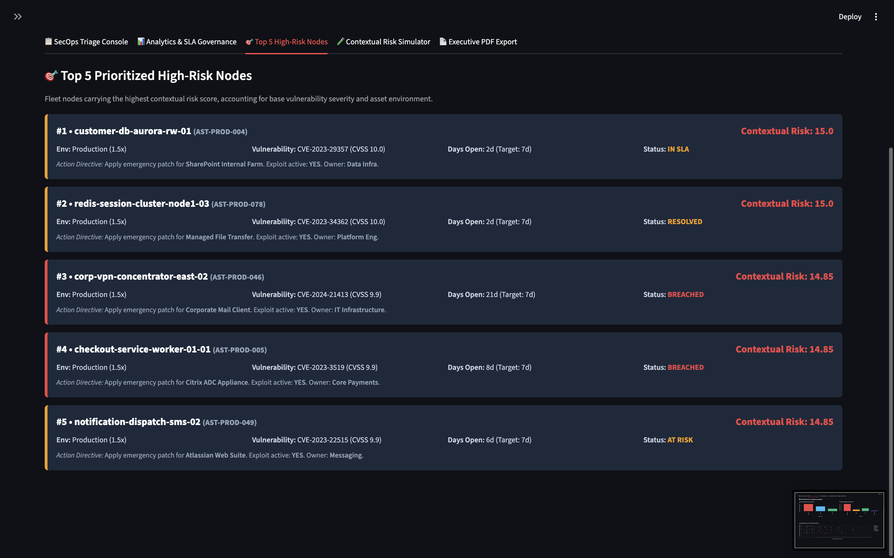
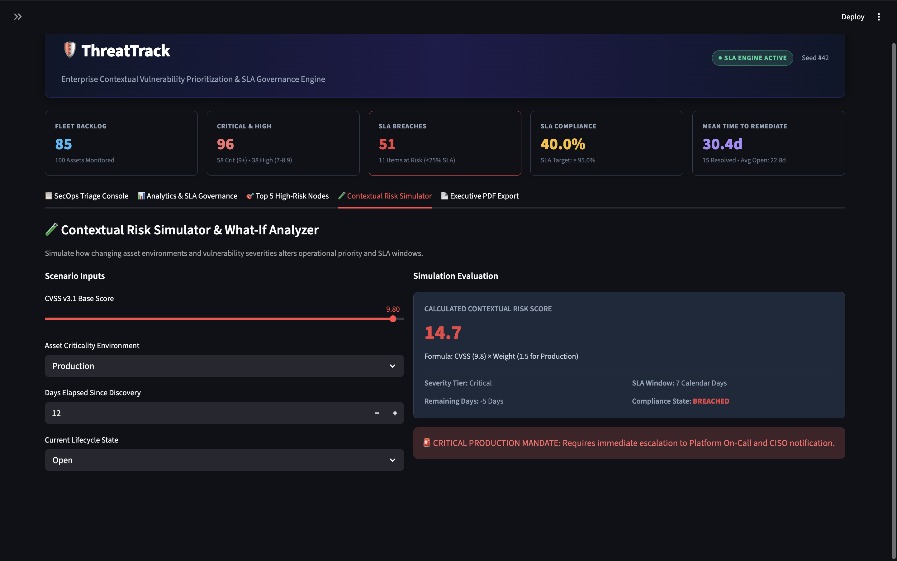
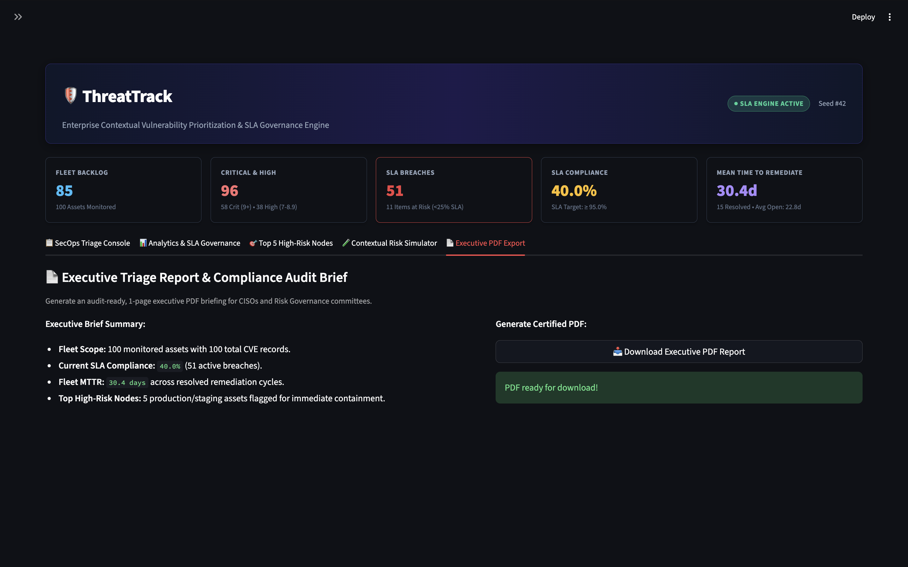
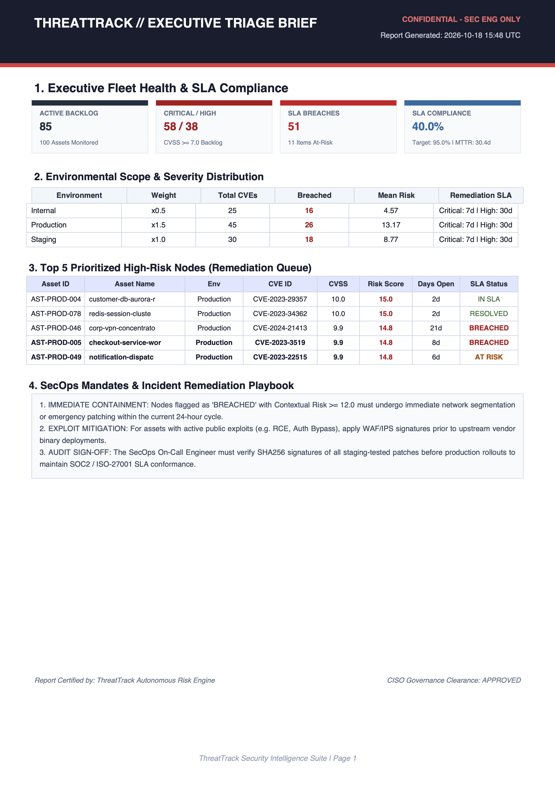
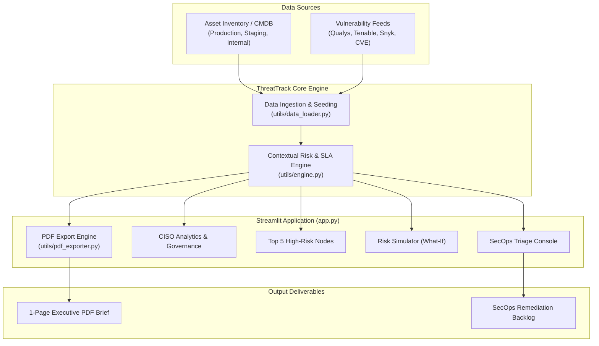

# 🛡️ ThreatTrack — Contextual Vulnerability Triage & SLA Platform

[](https://www.python.org/)
[](https://streamlit.io/)
[](https://www.iso.org/)
[](file:///Users/siya/ThreatTrack/product-docs/DATASHEET.md)
[](file:///Users/siya/ThreatTrack/product-docs/PRD.md)

**ThreatTrack** is a high-performance, enterprise-grade Vulnerability Triage and SLA Governance platform designed for modern Security Operations (SecOps), Platform Engineering, and Chief Information Security Officer (CISO) leadership.

It bridges the critical gap between raw vulnerability scanner outputs (e.g., Tenable, Qualys, Snyk, Wiz) and real-world business impact by combining **environmental context weighting** with **deterministic remediation SLA countdowns**.

---

## 🌟 Platform Overview



### The Problem ThreatTrack Solves
Modern security organizations face thousands of Common Vulnerabilities and Exposures (CVEs) weekly. Standard tools lead to two fundamental failures:
1. **Context Blindness:** A `CVSS 9.8` flaw on an isolated internal development sandbox triggers the exact same priority alert as a `CVSS 9.8` on a customer-facing production payment gateway.
2. **SLA Governance Blindspots:** Engineering and SecOps teams lack a single source of truth for tracking vulnerability aging against contractual and compliance Service Level Agreements (SLAs), leading to audit non-compliance (SOC 2, ISO 27001) and prolonged threat exposure.

### The ThreatTrack Solution
ThreatTrack introduces **Asset-Contextual Prioritization** and **Automated SLA Countdown Governance**:
$$\text{Contextual Risk Score} = \text{CVSS v3 Base Score} \times \text{Asset Criticality Weight}$$

| Environment | Weight | Description |
| :--- | :---: | :--- |
| **Production** | **1.5x** | Customer-facing services, payment gateways, primary datastores, auth endpoints |
| **Staging** | **1.0x** | Mirror clusters, pre-release staging, QA testbeds |
| **Internal** | **0.5x** | Dev sandboxes, internal documentation wikis, isolated build runners |

---

## 📸 Visual Walkthrough & Core Capabilities

### 1. 📋 SecOps Triage Console
The primary workspace for frontline security engineers to inspect, filter, and remediate vulnerabilities in real-time.



- **Multi-Faceted Filtering:** Slice the vulnerability queue by Environment (`Production`, `Staging`, `Internal`), Severity Tier (`Critical`, `High`, `Medium`, `Low`), SLA Status (`BREACHED`, `AT RISK`, `HEALTHY`), and Assigned Engineering Team.
- **Search & Quick Triage:** Search across assets, CVE IDs, components, and owner teams instantly.
- **Asset Detail Drawer:** Expand any vulnerability node to inspect CVSS metrics, contextual risk multipliers, exploit status, remediation guidance, and update triage status (`In Triage`, `Remediation In Progress`, `Resolved`, `Exception Approved`).

---

### 2. 📊 Executive Analytics & SLA Governance
Comprehensive macro-level reporting for CISOs, security directors, and compliance auditors.



- **Fleet KPI Ribbons:** Track total monitored nodes, active SLA breaches, enterprise SLA compliance rate ($\ge 95\%$ target), and Mean Time to Remediation (MTTR).
- **Environment Risk Distribution:** Interactive visual breakdowns identifying whether risk burden is concentrated in customer-facing production or non-critical tiers.
- **Aging vs. Risk Matrix:** Scatter visualizations plotting days open against contextual risk to expose neglected high-risk vulnerabilities.

---

### 3. 🎯 Top 5 High-Risk Nodes
Laser-focused triage on the enterprise's crown-jewel assets carrying extreme exposure.



- **Algorithmic Ranking:** Automatically prioritizes assets combining high CVSS exploitability, production exposure, and active exploit availability.
- **Deep Threat Context:** Displays affected components, in-the-wild exploit flags, aging countdowns, and direct team assignments.
- **Remediation Action Prompts:** Immediate operational guidance to trigger rapid containment and patching cycles.

---

### 4. 🧪 Contextual Risk Simulator ("What-If" Engine)
An interactive sandbox for SecOps analysts and architects to simulate posture changes before rolling out policy adjustments.



- **Scenario Modeling:** Adjust base CVSS scores, reclassify environment tiers, or toggle in-the-wild exploit intelligence.
- **Instant Mathematical Recalculation:** Watch contextual risk scores, severity tiers, and SLA deadlines update in real-time.
- **Operational Impact Analysis:** Evaluate how shifting an asset from Staging to Production transforms remediation urgency and compliance windows.

---

### 5. 📄 One-Click Certified Executive PDF Export
Generate audit-ready, 1-page executive briefs in vector PDF format for executive staff, Board of Directors risk committees, and GRC compliance reviews.

| PDF Export Interface | Generated Executive Brief Sample |
| :---: | :---: |
|  |  |

- **Vectorized Generation:** Built with [fpdf2](https://py-pdf.github.io/fpdf2/) for pixel-perfect executive presentation.
- **Audit-Ready Reporting:** Summarizes fleet compliance rates, MTTR, environmental breakdown, and the prioritized Top 5 critical nodes with security classification stamps.

---

## 📐 Mathematical Model & Governance Rules

### Contextual Risk Bands
$$\text{Contextual Risk Score} = \text{CVSS Base Score} \times \text{Asset Weight}$$

* **Extreme Risk ($\ge 12.0$):** Immediate 24-hour escalation, emergency change-freeze exemption.
* **High Risk ($8.0 - 11.9$):** Prioritized sprint backlog, immediate staging validation.
* **Moderate Risk ($4.0 - 7.9$):** Standard patch management cycle.
* **Low Risk ($< 4.0$):** Routine maintenance or accepted residual risk.

### SLA Remediation Thresholds
Remediation deadlines are calculated strictly from the initial discovery timestamp:

| Severity Tier | CVSS Score Range | Mandated SLA Target | Escalation Threshold ("At Risk") |
| :--- | :---: | :---: | :--- |
| **Critical** | $9.0 - 10.0$ | **7 Calendar Days** | $\le 2$ days remaining or $\ge 75\%$ elapsed |
| **High** | $7.0 - 8.9$ | **30 Calendar Days** | $\le 7$ days remaining or $\ge 75\%$ elapsed |
| **Medium** | $4.0 - 6.9$ | **60 Calendar Days** | $\le 14$ days remaining |
| **Low** | $0.1 - 3.9$ | **90 Calendar Days** | $\le 15$ days remaining |

---

## 🏗️ Architecture & Data Flow



---

## 📂 Project Directory Structure

```text
ThreatTrack/
├── app.py                     # Streamlit Main Dashboard Application
├── requirements.txt          # Python dependencies (Streamlit, Pandas, FPDF2, Altair)
├── PLAN.md                   # Initial Implementation Plan & Architecture
├── images/                   # Application screenshots & PDF visuals
│   ├── Dashboard.png                 # Main Executive Dashboard & KPI ribbon
│   ├── SecOps_Triage_Console.png     # Triage queue with multi-filter controls
│   ├── Analytics.png                 # Analytics charts and SLA compliance view
│   ├── High_Risk_Nodes.png           # Top 5 prioritized high-risk assets
│   ├── Risk_Sim.png                  # Interactive risk simulation sandbox
│   ├── Export_To_PDF.png             # In-app PDF generation tab
│   └── Exported_PDF.png              # Rendered executive PDF document sample
├── product-docs/             # Product & Engineering Collateral
│   ├── PRD.md                # Comprehensive Product Requirements Document
│   ├── RICE.md               # RICE Prioritization Framework Matrix
│   └── DATASHEET.md          # 1-Page Enterprise Product Datasheet & FAQ
└── utils/                    # Core Business Logic & Engines
    ├── data_loader.py        # Seed catalog & dataset ingestion pipeline
    ├── engine.py             # Contextual risk calculations & SLA governance engine
    └── pdf_exporter.py       # FPDF2 executive report compilation engine
```

### Key Modules
- [app.py](file:///Users/siya/ThreatTrack/app.py): Entry point for the Streamlit web dashboard. Houses the cyber dark SOC layout, interactive filters, metric cards, and all operational tabs.
- [utils/engine.py](file:///Users/siya/ThreatTrack/utils/engine.py): Implements [`calculate_risk_score`](file:///Users/siya/ThreatTrack/utils/engine.py#L50-L59), [`evaluate_sla`](file:///Users/siya/ThreatTrack/utils/engine.py#L62-L100), [`enrich_dataset`](file:///Users/siya/ThreatTrack/utils/engine.py#L102-L140), and [`compute_metrics`](file:///Users/siya/ThreatTrack/utils/engine.py#L142-L190).
- [utils/data_loader.py](file:///Users/siya/ThreatTrack/utils/data_loader.py): Generates deterministic mock enterprise infrastructure mapped to realistic CVEs (XZ Utils, HTTP/2 Rapid Reset, runc breakout, etc.).
- [utils/pdf_exporter.py](file:///Users/siya/ThreatTrack/utils/pdf_exporter.py): Contains the [`ThreatTrackPDF`](file:///Users/siya/ThreatTrack/utils/pdf_exporter.py#L13-L120) class and [`generate_executive_pdf`](file:///Users/siya/ThreatTrack/utils/pdf_exporter.py#L122-L236) function for compiling vector executive briefs.

---

## 🚀 Quickstart & Setup Guide

### 1. Prerequisites
- **Python:** 3.10 or higher (Tested on Python 3.10, 3.11, 3.12, 3.13)
- **Pip:** Package installer for Python

### 2. Installation
Clone the repository and navigate into the workspace:
```bash
git clone https://github.com/your-org/ThreatTrack.git
cd ThreatTrack
```

Create and activate a virtual environment:
```bash
# macOS / Linux
python3 -m venv venv
source venv/bin/activate

# Windows
python -m venv venv
venv\Scripts\activate
```

Install dependencies:
```bash
pip install -r requirements.txt
```

### 3. Launching the Platform
Start the Streamlit application:
```bash
streamlit run app.py
```

The application will launch automatically in your browser at:
```text
http://localhost:8501
```

---

## 📚 Product Documentation

ThreatTrack includes complete product management and governance specifications:
* **[Product Requirements Document (PRD.md)](file:///Users/siya/ThreatTrack/product-docs/PRD.md):** Deep dive into user personas (SecOps Analyst vs. CISO), problem statements, core epics, functional requirements, and metric targets.
* **[RICE Prioritization Framework (RICE.md)](file:///Users/siya/ThreatTrack/product-docs/RICE.md):** Mathematical scoring (Reach × Impact × Confidence / Effort) justifying feature sequencing across Phase 1 MVP, Phase 2 Enterprise Integrations, and Phase 3 Autonomous Remediation.
* **[Enterprise Product Datasheet (DATASHEET.md)](file:///Users/siya/ThreatTrack/product-docs/DATASHEET.md):** High-level capabilities, technical specs, air-gap readiness, 4-step onboarding quickstart, and customer FAQ.

---

## 🔒 Security, Compliance & Air-Gap Readiness

- **Zero Outbound Telemetry:** ThreatTrack does not send data, telemetry, or scanner outputs to external cloud endpoints.
- **Air-Gap Compatible:** Operates fully within isolated subnets, bastion networks, and sovereign cloud environments.
- **Audit-Verifiable Math:** Risk scoring and SLA calculations are deterministic and transparent—no opaque machine learning or unvalidated heuristics.

---

## 📄 License & Attribution

This project is licensed under the Apache 2.0 License. Built for enterprise cybersecurity teams seeking actionable vulnerability intelligence.
