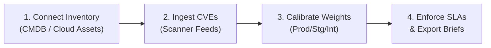

# ThreatTrack — Enterprise Product Datasheet

**ThreatTrack** is a lightweight, high-performance Vulnerability Triage and SLA Governance platform engineered for modern SecOps and CISO organizations. It cuts through the noise of raw scanner outputs by contextualizing vulnerability severity against business criticality and strictly enforcing remediation deadlines.

---

## 1. Key Capabilities at a Glance

### 🛡️ Contextual Risk Scoring Engine
Eliminates CVSS alert fatigue by computing true business exposure:
$$\text{Contextual Risk Score} = \text{CVSS v3 Score} \times \text{Asset Weight}$$
* **Production Assets (1.5x):** High-priority customer-facing services and critical datastores.
* **Staging Assets (1.0x):** Pre-production environments and integration testbeds.
* **Internal Assets (0.5x):** Developer tooling, internal documentation, and sandbox clusters.

### ⏱️ Dynamic SLA Lifecycle Governance
Tracks aging from discovery timestamp to enforce enterprise remediation policies:
* **Critical (CVSS 9.0 - 10.0):** **7-Day SLA** with automated 48-hour "At-Risk" warnings.
* **High (CVSS 7.0 - 8.9):** **30-Day SLA** with automated 7-day escalation flags.
* **Compliance Tracking:** Real-time visibility into overall enterprise SLA compliance rate ($\ge 95\%$ target) and Mean Time to Remediation (MTTR).

### 🖥️ Interactive SecOps Triage Console
Single pane of glass for vulnerability triage with fast search, multi-faceted filtering, asset detail drawers, and direct lifecycle status updating (`In Triage`, `Remediation In Progress`, `Resolved`, `Exception Approved`).

### 📊 Executive Analytics & What-If Simulator
Visualizes environmental risk distributions, aging scatterplots, and includes an interactive simulator allowing engineers to test CVSS changes and asset re-classifications before operational rollout.

### 📄 One-Click Certified Executive PDF Export
Generates audit-ready, 1-page executive briefs summarizing fleet posture, MTTR, environmental distributions, and the Top 5 prioritized high-risk nodes for executive and regulatory reporting.

---

## 2. Technical Specifications & Architecture

| Parameter | Specification |
| :--- | :--- |
| **Application Runtime** | Python 3.10+ (Tested on Python 3.13 & 3.14) |
| **User Interface** | Streamlit 1.55+ (High-Performance Responsive Cyber Dark Theme) |
| **Analytics Engine** | Pandas 2.0+, Altair 5.0+ |
| **Reporting Engine** | FPDF2 2.8+ / ReportLab 4.0+ (Vectorized PDF Rendering) |
| **Deployment Footprint** | Cloud VM (AWS EC2 / GCP Compute), Docker Container, Kubernetes Pod, or Local Air-Gapped Workstation |
| **Network Requirements** | **100% Self-Contained / Air-Gap Compatible.** Zero outbound telemetry or external cloud dependencies required. |
| **Data Ingestion** | Ingests from CSV, JSON, Parquet, or CMDB REST APIs |
| **Resource Utilization** | Minimal: $< 250\text{MB}$ RAM for $10,000+$ active vulnerability nodes |

---

## 3. Four-Step Customer Onboarding Quickstart

1. **Step 1: Connect Asset Inventory:** Connect your existing CMDB (AWS, Azure, GCP, or internal asset DB) to map hostname to environment tier (`Production`, `Staging`, `Internal`).
2. **Step 2: Ingest Scanner Feeds:** Pipe vulnerability scan results (Qualys, Tenable, Snyk, Trivy, Grype) into the ThreatTrack catalog.
3. **Step 3: Calibrate Policies:** Confirm or tune default asset criticality weights and SLA calendar days according to your organization's risk tolerance.
4. **Step 4: Launch Governance:** Run the triage console daily and distribute weekly 1-click Executive PDF briefs to the CISO and audit teams.

---

## 4. Frequently Asked Questions (FAQ)

#### Q: How does ThreatTrack differ from vulnerability scanners like Tenable or Qualys?
**A:** Scanners identify technical vulnerabilities and output raw CVSS scores. ThreatTrack is a **triage and SLA governance layer** that sits downstream of your scanners. It attaches organizational context (e.g. is this node in production? who owns it? is there an active exploit?) and tracks strict compliance deadlines.

#### Q: Can ThreatTrack operate in an air-gapped or high-security enclave?
**A:** Yes. ThreatTrack was engineered from day one to operate with zero external dependencies. All data processing, mathematical scoring, and PDF generation occur locally within your security boundary.

#### Q: Can our team customize the asset weights and SLA days?
**A:** Absolutely. Asset weights and SLA thresholds are modularized in `utils/engine.py` and can be adjusted to match custom organizational compliance frameworks (e.g. FedRAMP, HIPAA, SOC 2).

#### Q: How is Mean Time to Remediation (MTTR) calculated?
**A:** MTTR is calculated as the mean elapsed days from initial vulnerability discovery to verified `Resolved` lifecycle state across all closed tickets within the reporting window.
