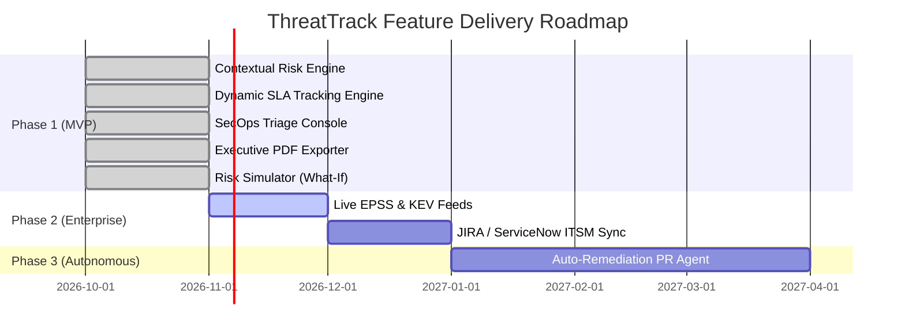

# ThreatTrack — RICE Prioritization Framework Matrix

The **RICE Scoring Model** is utilized by the ThreatTrack Product & Security Engineering teams to objectively prioritize product capabilities, architectural refactors, and feature roadmap investments.

$$\text{RICE Score} = \frac{\text{Reach} \times \text{Impact} \times \text{Confidence}}{\text{Effort}}$$

---

## 1. Scoring Dimension Definitions

| Dimension | Scale / Units | Criteria & Rationale |
| :--- | :--- | :--- |
| **Reach (R)** | Estimated users or assets impacted per quarter | **500 - 10,000+** representing monitored enterprise nodes or weekly SecOps/Engineering user interactions. |
| **Impact (I)** | Multiplier (0.25 to 3.0) | **3.0** = Massive risk reduction / eliminates audit failure **2.0** = High operational velocity improvement **1.0** = Moderate workflow enhancement **0.5** = Minor quality of life enhancement **0.25** = Minimal measurable delta |
| **Confidence (C)** | Percentage (50% to 100%) | **100%** = High confidence backed by verified data, working prototypes, and clear stakeholder requirements. **80%** = Medium confidence; strong technical viability with minor external dependencies. **50%** = Low confidence; speculative or unvalidated API integrations. |
| **Effort (E)** | Person-Weeks (Sprints) | Estimated engineering person-weeks required to specify, implement, test, and release the capability. |

---

## 2. Comprehensive Feature Prioritization Matrix

| Rank | Feature / Initiative | Reach (Quarterly) | Impact (Scale) | Confidence (%) | Effort (Weeks) | RICE Score | Release Phase |
| :---: | :--- | :---: | :---: | :---: | :---: | :---: | :---: |
| **1** | **Contextual Risk Engine ($\text{CVSS} \times \text{Weight}$)** Mathematically blends asset criticality with CVSS. | 10,000 assets | 3.0 (Massive) | 100% (1.0) | 1.5 wks | **20,000** | **Phase 1 (MVP)** |
| **2** | **Dynamic SLA Tracking & Breach Alerter** Enforces 7d Critical & 30d High countdowns. | 10,000 assets | 3.0 (Massive) | 100% (1.0) | 2.0 wks | **15,000** | **Phase 1 (MVP)** |
| **3** | **Interactive SecOps Triage Console** Multi-filter UI with asset detail drawer and status updating. | 5,000 queries | 2.0 (High) | 100% (1.0) | 2.0 wks | **5,000** | **Phase 1 (MVP)** |
| **4** | **1-Click Executive PDF Exporter** Audit-ready PDF summary for CISOs & GRC boards. | 1,200 reports | 2.0 (High) | 90% (0.9) | 1.5 wks | **1,440** | **Phase 1 (MVP)** |
| **5** | **Contextual Risk Simulator (What-If)** Interactive scenario modeling for SecOps planning. | 800 sessions | 1.0 (Moderate) | 100% (1.0) | 1.0 wks | **800** | **Phase 1 (MVP)** |
| **6** | **JIRA / ServiceNow Bi-Directional Sync** Automated ticket creation and status synchronization. | 4,000 tickets | 2.0 (High) | 80% (0.8) | 6.0 wks | **1,067** | **Phase 2 (Roadmap)** |
| **7** | **Live EPSS & CISA KEV Feed Ingestion** Automated exploit prediction and known exploited feeds. | 8,000 assets | 1.5 (High) | 70% (0.7) | 4.0 wks | **2,100** | **Phase 2 (Roadmap)** |
| **8** | **Autonomous Terraform / GitOps Remediation** Generates automated pull requests for vulnerable packages. | 2,500 PRs | 3.0 (Massive) | 50% (0.5) | 10.0 wks | **375** | **Phase 3 (Long-Term)** |

---

## 3. Detailed Feature Analysis & Justifications

### 3.1 Tier 1: Immediate MVP Implementations (Delivered in v1.0)
* **Contextual Risk Scoring ($\text{RICE: } 20,000$):** Highest impact-to-effort ratio. Solves the foundational problem of CVSS alert fatigue in production environments with simple, transparent math ($\text{CVSS} \times \text{Weight}$).
* **Dynamic SLA Tracking ($\text{RICE: } 15,000$):** Addresses the critical compliance requirement for SOC 2 and ISO 27001 audits. Automatically highlights `BREACHED` and `AT RISK` assets.
* **SecOps Triage Console & Inspector ($\text{RICE: } 5,000$):** Provides the single pane of glass required for daily operational triage.
* **Executive PDF Exporter ($\text{RICE: } 1,440$):** Unblocks CISO reporting without requiring executive logins or manual slide deck assembly.
* **Contextual Risk Simulator ($\text{RICE: } 800$):** High-value interactive utility for what-if scenario testing during zero-day disclosure triage.

### 3.2 Tier 2: Enterprise Integrations (Scheduled for v1.1 - v1.2)
* **Live EPSS & CISA KEV Feed ($\text{RICE: } 2,100$):** Enhances CVSS with real-world probability of exploitation within 30 days. High impact, but requires external feed caching and rate limit governance.
* **JIRA / ServiceNow ITSM Sync ($\text{RICE: } 1,067$):** Essential for large enterprise ticketing environments, but carries significant integration overhead across heterogeneous ticketing schemas.

### 3.3 Tier 3: Future Autonomous Workflows (Scheduled for v2.0)
* **Autonomous Remediation PRs ($\text{RICE: } 375$):** Groundbreaking long-term capability, but requires substantial investment in repo parsing, build verification, and regression guardrails. Lower initial RICE due to 10-week effort and 50% initial confidence.

---

## 4. Resource Allocation & Roadmap Alignment

